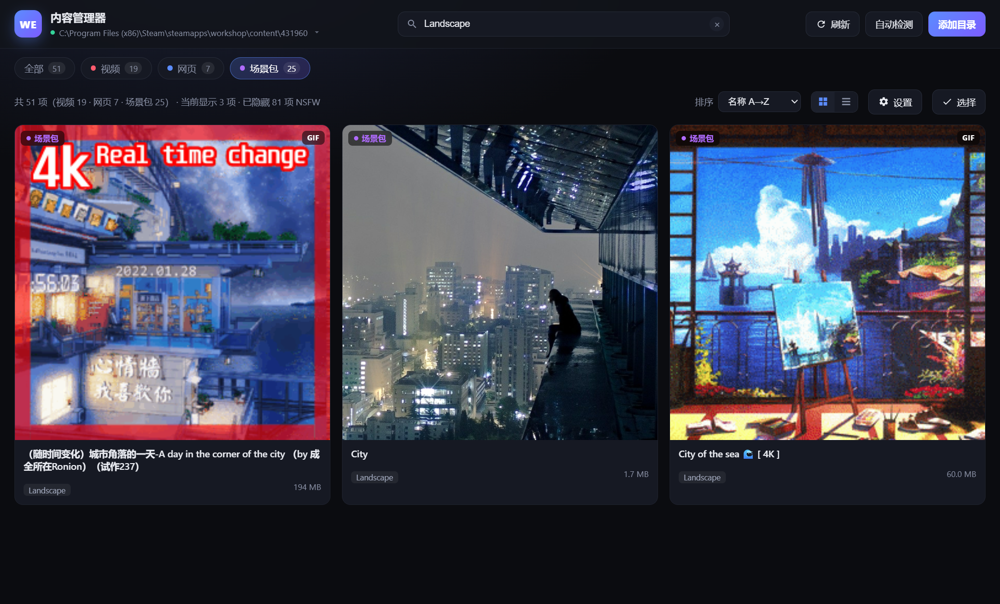
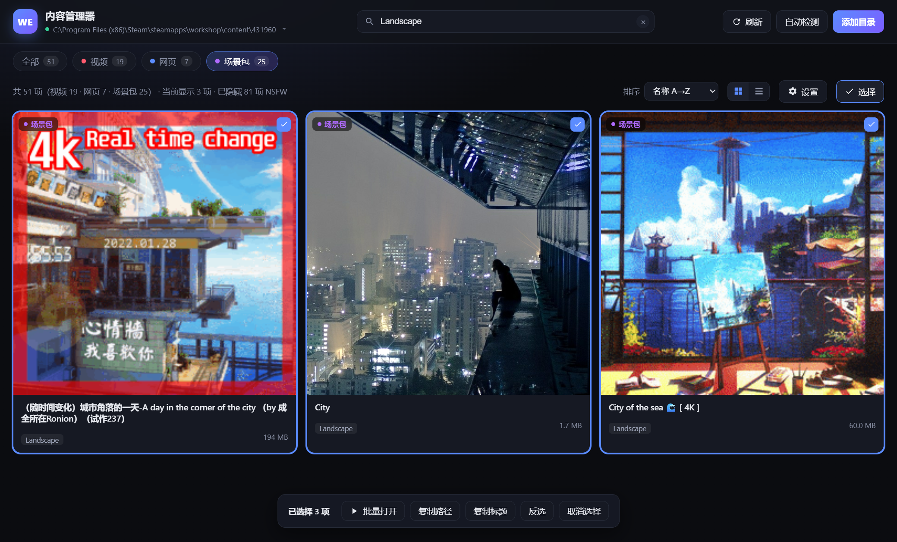
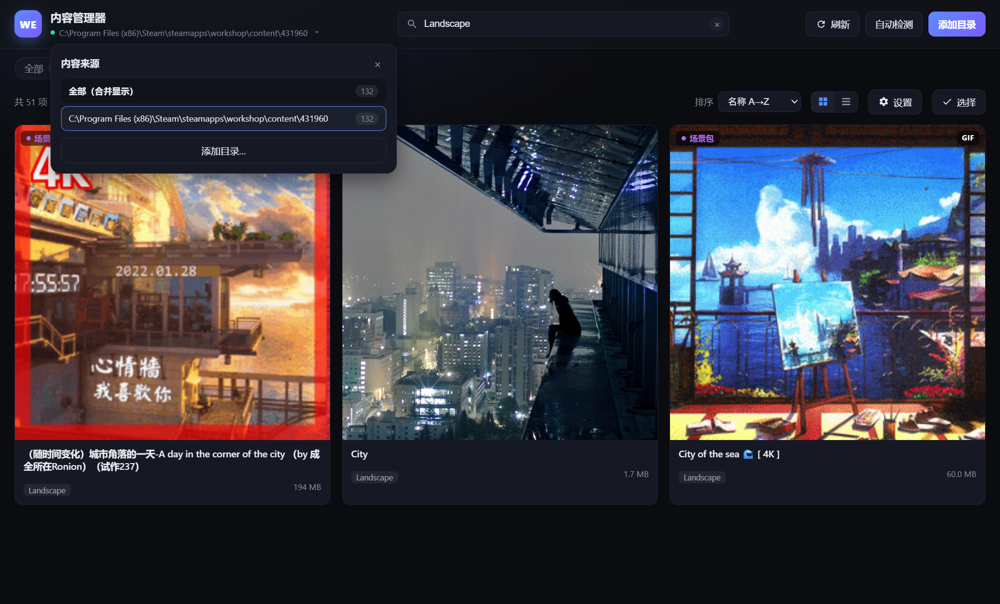
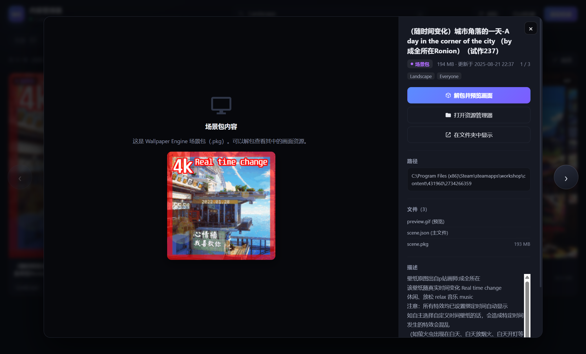
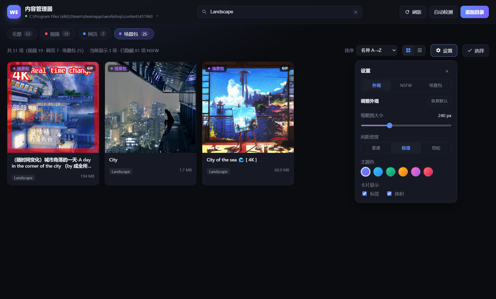
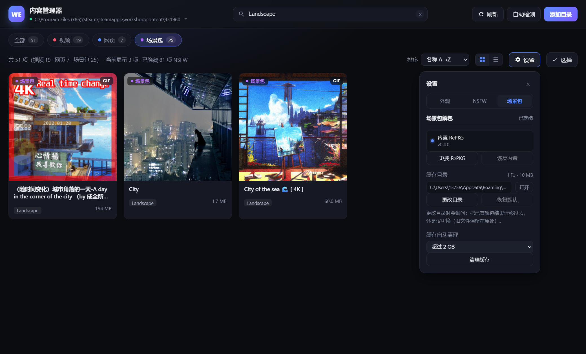

# Wallpaper Engine 内容管理器

一个基于 Electron 的 Wallpaper Engine（Steam AppID `431960`）订阅内容管理器。

浏览你订阅的全部壁纸，**视频和图片可以在管理器内直接播放/查看**，其他无法直接渲染的类型（场景包 `.pkg`、素材包等）可以一键打开资源管理器查看。



> 文中所有截图统一取自「场景包」分类，并用 `Landscape` 标签过滤、开启「隐藏 NSFW 内容」，因此画面中只有城市风景类内容。

多选模式（`Ctrl` / `Shift` 点击，底部为批量操作栏）：



多个 Steam 库合并浏览，点顶栏可切换来源：



详情页（弹窗外侧箭头切换项目；内侧箭头与 `←` `→` 只切当前项目的图片 / 快进视频）：



## 功能

- **自动定位**：从注册表 / 常见安装路径 / `libraryfolders.vdf` 中自动找出 Steam 库、订阅目录与 Wallpaper Engine 本地项目目录
- **多库合并**：同时扫描多个 Steam 库的订阅目录，合并成一个列表，也可按来源单独查看（见上方截图）
- **自动分类**：读取每一项的 `project.json`，按实际内容归类为 视频 / 图片 / 网页 / 场景包 / 程序 / 其他
- **卡片式浏览**：使用订阅目录里的 `preview.*` 作为缩略图，GIF 预览会动，支持网格 / 列表两种视图
- **内置预览**：
  - 视频 → 弹窗内直接播放（支持拖动进度条）
  - 图片 → 弹窗内直接查看
  - 多份媒体文件可切换
  - 其他 / 程序类型：目录（含子目录）里有视频或图片时同样能预览 —— 很多「其他」其实是别的壁纸的预设包
- **一键打开**：
  - 卡片悬停处的播放按钮 → 视频直接用系统默认播放器打开，不经过内置弹窗
  - 弹窗内 → 视频 / 图片可用系统默认播放器 · 看图工具打开
  - 网页壁纸 → 默认浏览器，或独立窗口打开
  - 场景包 → 打开详情弹窗，可在里面解包预览画面
  - 程序 / 未知类型 → 打开资源管理器
- **场景包解包**：调用随包内置的 RePKG（v0.4.0-alpha）把 `.pkg` 解开，直接预览里面的画面资源（详见下文）
- **右键原生菜单**：在卡片上点右键可打开 / 解包并预览 / 用默认程序打开 / 打开资源管理器 / 在文件夹中显示 / 复制标题·路径·创意工坊 ID / 在 Steam 创意工坊中查看
- **键盘导航**：方向键在卡片间移动，`Home` / `End` 跳到首尾，`空格` 打开或勾选
- **多选批量操作**：`Ctrl` / `Shift` 点击选择，或 `Ctrl+A` 全选，支持批量打开、批量复制路径 / 标题
- **封面统一正方形**：不同比例的预览图按正方形等比裁切，网格与列表视图的卡片高度一致、排版整齐
- **外观可调**：在「设置 → 外观」里调整缩略图大小（170–400 px）、间距密度（紧凑 / 标准 / 宽松）、6 套主题色、标签与体积的显隐，全部实时生效并记忆；「恢复默认」只作用于这一组
- **搜索与筛选**：按标题、标签、ID、描述搜索；按类型筛选；多种排序方式
- **详情面板**：标题、类型、体积、更新时间、标签、分级、描述、文件清单、路径（点击复制）
- **详情页快速切换**：弹窗**外侧**的圆形箭头、`↑` `↓` 或 `Alt + ←` `Alt + →` 切换上一个 / 下一个项目，右上角显示当前位置（如 `12 / 290`）；弹窗**内侧**的 `‹` `›` 与 `←` `→` 只作用于当前项目——图集切图片、视频快退快进
- **图集缩略条**：缩略图由主进程压成 96 px 小图（不直接解码几十 MB 的原图），按可视区域懒加载并在空闲时补齐；2.6 秒无操作自动淡出，滚轮可横向快速浏览，点击即切换
- **视频键盘控制**：弹窗打开后无需点击或聚焦即可用键盘操作 —— `←` `→` 快退 / 快进 5 秒，`空格` 播放 / 暂停，`M` 静音，`F` 全屏（详见「快捷键」）
- **NSFW 内容管理**（「设置 → NSFW」）：
  - **隐藏 NSFW 内容**：默认关闭；开启后列表、类型筛选计数与详情页上一个 / 下一个都会跳过这些条目，状态栏会显示「已隐藏 N 项 NSFW」
  - **模糊 NSFW 封面**：默认开启；只模糊封面图（网格 / 列表 / 详情页），标题与标签保持清晰，鼠标悬停或键盘聚焦时临时显示原图
  - **老板键**：任何时候按 `Ctrl + Shift + H` 立即隐藏窗口并静音，再按一次恢复；设置面板里也可点「立即隐藏窗口」

## 快速开始

```bash
npm install
npm start
```

首次启动会自动检测订阅目录；若检测失败，点击右上角「更换目录」，选择：

```
<Steam 库>\steamapps\workshop\content\431960
```

也可以直接点「更换目录」选择 Wallpaper Engine 的本地项目目录
（`...\common\wallpaper_engine\projects\myprojects`），管理器同样可以扫描。

> 环境要求：Node.js 18+（本项目的 Electron 版本为 38.x，安装脚本兼容 Node 18/20/22）。
> 装好依赖后日常使用就不需要 Node 和 npm 了。

## 启动方式

| 方式 | 说明 |
| --- | --- |
| **打包版（推荐）** | 双击 `dist\win-unpacked\WE Content Manager.exe`，自带 Electron 运行时，不依赖 Node / npm |
| **`启动.cmd`** | 开发模式，等价于 `npm start`，依赖 `node_modules`；改完前端按 `Ctrl+R` 立刻生效 |
| 固定到任务栏 | 右键桌面快捷方式 → 「固定到任务栏」，之后点一下就能开 |

桌面上的「Wallpaper Engine 内容管理器」快捷方式已指向**打包版**，双击即用。

两种方式共用同一个配置目录 `%APPDATA%\WE Content Manager`，目录列表、外观、偏好完全互通。

- 快捷方式记录的是绝对路径，**移动项目文件夹后会失效**，按下面命令重建即可；
  `启动.cmd` 用 `%~dp0` 定位自身，项目移动后依然可用。
- 快捷方式用的是 Electron 默认图标。想换图标：右键快捷方式 → 属性 → 更改图标。

```powershell
# 需要时重建桌面快捷方式
$app = "<项目绝对路径>"
$exe = "$app\dist\win-unpacked\WE Content Manager.exe"
$ws = New-Object -ComObject WScript.Shell
$lnk = $ws.CreateShortcut((Join-Path ([Environment]::GetFolderPath('Desktop')) "Wallpaper Engine 内容管理器.lnk"))
$lnk.TargetPath = $exe
$lnk.WorkingDirectory = "$app\dist\win-unpacked"
$lnk.IconLocation = "$exe,0"
$lnk.Save()
```

## 打包成独立程序

```bash
npm run dist:dir
```

产物在 `dist\win-unpacked\`（约 320 MB），其中 `WE Content Manager.exe` 可直接双击。
整个文件夹可以拷到任意路径，甚至拷给没装 Node 的电脑。

几个刻意的配置：

| 配置 | 原因 |
| --- | --- |
| `asar: false` | 不打成 asar 包，`resources\app\renderer\` 里的前端源码可直接修改，改完重开应用即可 |
| `electronDist` | 复用 `node_modules\electron\dist`，打包时不必重新下载 Electron |
| `signAndEditExecutable: false` | 跳过 winCodeSign 工具下载；本地自用不需要代码签名 |

> electron-builder 的版本锁定在兼容 Node 20 的 24.x（26.x 使用 ESM 依赖，Node 20 无法加载）。

## 修改前端

前端是**纯 HTML/CSS/JS，没有任何构建步骤**。直接改 `renderer/` 下的文件即可：

```
renderer/
├── index.html   页面结构（工具栏、设置面板、批量操作栏、详情弹窗）
├── style.css    样式（深色主题，配色与尺寸集中在文件顶部的 CSS 变量里）
└── app.js       全部界面逻辑
                 ├─ KINDS / THEMES / DENSITIES   分类、主题、密度等常量
                 ├─ 渲染与筛选（buildCard / render / computeList）
                 ├─ 打开行为（单击、右键菜单、外部程序、资源管理器）
                 ├─ 多选与批量操作（runBulk）
                 └─ 键盘导航（moveFocus / setFocusIndex）
```

改完在应用里按 `Ctrl + R`（或菜单「视图 → 重新加载界面」）就能看到效果，不需要重启进程。
调试时按 `F12` 打开开发者工具。

用打包版时，对应目录是 `dist\win-unpacked\resources\app\renderer\`（因为配置了 `asar: false`），
同样是改完重开应用即可。也可以改项目源码后重新 `npm run dist:dir`。

## 项目结构

```
启动.cmd             开发模式双击启动（免 npm / 免终端）
dist/win-unpacked/   打包产物（npm run dist:dir 生成，不纳入版本管理）
main.js              主进程：窗口、应用菜单、IPC、右键原生菜单、
                     we-asset 资源协议、多目录扫描、配置读写
preload.js           contextBridge 安全桥接（渲染进程只能调用白名单 API）
src/scanner.js       Steam 库定位 + 订阅扫描 + project.json 解析 + 类型判定
src/pkg.js           RePKG 探测 + .pkg 解包 + 缓存管理与还原
vendor/RePKG/        随包分发的 RePKG.exe（v0.4.0-alpha，见下文「找到 RePKG」）
renderer/            界面（可直接修改）
```

渲染进程与主进程的分工：能纯前端做完的（渲染、筛选、多选、键盘导航、外观）全部留在
`renderer/`；只有需要系统能力的动作（打开文件、弹原生菜单、读写剪贴板与配置）才通过
IPC 交给主进程。新增交互时照这个边界放代码即可。

### 关于 `we-asset://` 协议

订阅内容散落在磁盘任意位置，为了让渲染进程安全地引用这些文件（尤其是能拖动进度条的
视频流），主进程注册了一个自定义协议：

```
we-asset://local/?p=<encodeURIComponent(绝对路径)>
```

它支持 HTTP Range 请求，所以视频可以边下边播、随意跳转。界面里所有缩略图、视频、
图片都走这个协议，因此 CSP 里只需要放行 `we-asset:`。

## 类型判定规则

| 类型 | 判定依据 | 单击卡片的行为 |
| --- | --- | --- |
| 视频 | 存在 `.mp4/.webm/.avi/.mov/.mkv` 等视频文件 | 弹窗内播放 |
| 图片 | 存在内容图片且无场景包 | 弹窗内查看 |
| 网页 | `project.json` 的 `type` 为 `web` 且含 `.html`，或含 `.html` | 打开浏览器 |
| 场景包 | 存在 `.pkg` 文件，或存在 `contents/` 资源目录 | 打开详情弹窗（可解包预览画面） |
| 程序 | 存在 `.exe` | 打开资源管理器（目录里有媒体则改为打开详情预览） |
| 其他 | 以上都不是 | 打开资源管理器（目录里有媒体则改为打开详情预览） |

`preview.*` 和 `project.json` 不会被当作内容文件。

「其他」类型不代表没有画面：顶层没有媒体时，扫描会向下找**最多 3 层子目录**（最多 60 个文件，
跳过 `node_modules` / `cache` 等目录），找到的视频、图片照样能预览；
如果子目录里找到了视频，该项目会直接归入「视频」。带 `.pkg` 的项目不做补扫，
仍由 RePKG 解包处理。

## 场景包（.pkg）解包

场景包是 Wallpaper Engine 的私有打包格式，管理器自己不解析，而是调用
[RePKG](https://github.com/notscuffed/repkg) 把内容导出来：

```
RePKG.exe extract -o <缓存目录> --overwrite <scene.pkg>
```

RePKG 默认会把 `.tex` 贴图转成 PNG，所以解包后能直接拿到场景画面。

### 找到 RePKG

项目自带 [RePKG v0.4.0-alpha](https://github.com/notscuffed/repkg/releases/tag/v0.4.0-alpha)：
`vendor/RePKG/RePKG.exe`（自包含单文件，不需要另装 .NET 运行时），已通过
`package.json` 的 `build.files` 纳入打包，随应用一起分发。

查找顺序：

1. 用户在「设置 → 场景包 → 改用其他 RePKG.exe」里手动指定的路径（`repkgPath`）
2. 随包内置的 `vendor/RePKG/RePKG.exe`
3. 本机已安装的版本：`C:\RePKG\RePKG.exe`、`%ProgramFiles%\RePKG\RePKG.exe`、`PATH` 目录等

因此开箱即可解包，无需额外下载；想换版本时既可以指定外部 exe，也可以直接替换
`vendor/RePKG/RePKG.exe` 后重新打包。

设置面板里只显示**来源与版本**（如「内置 RePKG · v0.4.0」与「已就绪」），不再铺开完整路径 ——
路径对日常使用没有意义，需要排查时看配置文件的 `repkgPath` 即可。

指定过外部 exe 之后想退回随包版本：点旁边的「恢复内置」，会清空 `repkgPath` 并重新探测；
正在使用内置版本时该按钮置灰。

### 使用

打开任意场景包的详情弹窗 → **解包并预览画面**。解包完成后媒体区直接显示从 pkg 里
解出来的图片，底部缩略条可以切换查看其余贴图（主画面按文件体积排在最前面）。

解包是**按需触发**的，扫描和浏览列表时不会自动解包，避免拖慢启动。

### 缓存策略

| 项目 | 说明 |
| --- | --- |
| 默认位置 | `%APPDATA%\WE Content Manager\pkg-cache\<订阅ID>\` |
| 更改目录 | 「设置 → 场景包 → 缓存目录」可改到其它磁盘；路径单行显示，旁边「打开」直接进资源管理器 |
| 目录识别 | 缓存目录里会写一个 `.pkg-cache.json` 标记；只有**空文件夹**或**带标记的目录**才会被采用。选了已有其它文件（且无标记）的文件夹会被直接拒绝，避免缓存混入用户文件、或清理时误删 |
| 旧缓存兼容 | 升级前的缓存目录没有标记，启动时若里面只有订阅 ID 子目录会自动补标记，旧缓存不丢 |
| 换目录时的旧缓存 | 三选一：**迁移到新目录**（把已解包画面搬过去）/ **仅切换**（旧文件留在原处不再使用）/ **取消**。同盘迁移是移动，跨盘为复制后删除；新目录已有同名条目时保留新的 |
| 为什么不用订阅目录 | Steam 会校验订阅文件夹，写进去可能被覆盖或导致订阅异常 |
| 失效判断 | 记录 pkg 的大小与修改时间，任一变化才重新解包 |
| 重启后 | 自动从缓存还原，打开弹窗即可直接看到画面，不必重新解包 |
| 空间占用 | 纹理转 PNG 后可能比原 pkg 更大（实测单个场景包约 200 MB） |
| 自动清理 | 可设上限（默认 2 GB，可选 512 MB ~ 10 GB 或关闭）。解包后若超限，按**最久未使用**淘汰旧条目；刚解包的那个不会被删 |
| 手动清理 | 设置面板一键清空；把上限调小时会立即按新上限收敛一次 |

> 解包产物仅供本机查看壁纸内容使用，请勿再分发。

## 配置文件

界面偏好与扫描目录保存在：

```
%APPDATA%\WE Content Manager\config.json
```

主要字段：

| 字段 | 说明 |
| --- | --- |
| `rootDirs` | 要扫描的目录列表，可跨多个 Steam 库 |
| `activeDir` | `"all"` 表示合并显示，否则为某个具体目录的完整路径 |
| `appearance` | 缩略图大小、间距密度、主题色、标签/体积显隐 |
| `nsfw` | `{ hide, blur }`：是否隐藏 NSFW 内容、是否模糊 NSFW 封面（默认 `{ hide: false, blur: true }`） |
| `viewMode` / `sortBy` | 视图模式与排序方式 |
| `repkgPath` | 手动指定的 RePKG.exe 路径，为空则优先用内置版本，再探测本机安装 |
| `pkgCacheLimitMB` | 解包缓存上限（MB），`0` 表示不自动清理 |
| `pkgCacheDir` | 自定义解包缓存目录，`null` 表示使用默认的 `userData/pkg-cache` |

删除该文件即可恢复默认（会重新自动检测目录）。

开发模式与打包版共用这个文件，改一边另一边也会生效。

## 快捷键

### 列表

| 快捷键 | 功能 |
| --- | --- |
| `/` | 聚焦搜索框 |
| `↑` `↓` `←` `→` | 在卡片间移动焦点 |
| `Home` / `End` | 跳到第一张 / 最后一张卡片 |
| `空格` | 打开当前焦点项；多选模式下改为勾选 |
| `Enter` | 打开焦点卡片 |
| `Ctrl + A` | 全选当前列表（进入多选模式） |
| `Ctrl` / `Shift` + 点击卡片 | 多选 / 范围选择 |
| `Esc` | 关闭弹窗 → 关闭设置面板 → 退出多选 |
| `F5` | 重新扫描 |
| `Ctrl + O` | 选择订阅目录 |
| `Ctrl + R` | 重新加载界面（改完前端后用） |

### 详情弹窗（存在优先级，从上到下依次匹配）

| 快捷键 | 功能 | 说明 |
| --- | --- | --- |
| `Alt + ←` / `Alt + →` | 上一个 / 下一个**项目** | 任何媒体下都可用 |
| `↑` / `↓` | 上一个 / 下一个**项目** | 任何媒体下都可用，避开播放器的方向键 |
| `←` / `→` | 视频：快退 / 快进 5 秒 | 视频优先 |
| `←` / `→` | 图集：上一张 / 下一张**图片** | 只在当前项目内切换，不会翻项目 |
| `空格` | 播放 / 暂停 | 视频存在时 |
| `M` | 静音切换 | 视频存在时 |
| `F` | 全屏 / 退出全屏 | 视频存在时 |
| `Esc` | 关闭弹窗 | |

播放器的按键由 `document` 层统一处理，不依赖 `video` 获得焦点，所以弹窗打开后直接按键即可。

界面上区分得很清楚：

- **弹窗外侧**的两个圆形箭头 → 切换项目（上一个 / 下一个）
- **弹窗内侧**画面两边的 `‹` `›` → 只操作当前项目：图集切上一张 / 下一张，视频快退 / 快进 5 秒；只有一份媒体时自动隐藏

图集下方的缩略条：2.6 秒无操作自动淡出，鼠标移到画面上会重新出现；缩略图过多时可以用**滚轮横向快速浏览**，点任意一张即可切换。

### 全局

| 快捷键 | 功能 |
| --- | --- |
| `Ctrl + Shift + H` | 老板键：隐藏窗口并静音，再按一次恢复 |

## 设置

点工具栏的「设置」按钮打开面板。面板顶部是三个标签页 —— **外观 / NSFW / 场景包**，一次只显示一组，所以内容再增加也不会把面板拉长到需要滚动；全部设置实时生效并写入配置文件。

### 外观



| 项目 | 说明 |
| --- | --- |
| 缩略图大小 | 170 – 400 px，控制网格的列宽 |
| 间距密度 | 紧凑 / 标准 / 宽松，控制卡片间距 |
| 主题色 | 6 套预设，作用于按钮、选中态、焦点框、筛选高亮 |
| 卡片显示 | 标签、体积的显隐 |

分组标题右侧的「恢复默认」只重置这一组，不影响 NSFW 与其他设置。

### NSFW

判定依据为 `project.json` 的 `contentrating` 与 `tags`（如 `Mature`、`NSFW`、`Nudity`、`Sexual Content`、`R18` 等），识别数量显示在该分组标题右侧。

| 选项 | 默认值 | 生效范围 |
| --- | --- | --- |
| 隐藏 NSFW 内容 | 关闭 | 列表（网格 / 列表视图）、类型筛选计数、状态栏统计、详情页上一个 / 下一个、多选（已选中的 NSFW 项会被移出选择集） |
| 模糊 NSFW 封面 | 开启 | 仅封面图：网格卡片、列表卡片、详情页占位封面；标题与标签不模糊；悬停 / 键盘聚焦时临时显示原图 |
| 老板键 `Ctrl + Shift + H` | 全局可用 | 隐藏主窗口并静音正在播放的视频，再按一次恢复；再次启动应用也会把隐藏的窗口叫回来 |

### 场景包



| 区块 | 内容 |
| --- | --- |
| RePKG 状态 | 只显示来源与版本（「内置 RePKG · v0.4.0」/「外部 RePKG」）和右侧的「已就绪 / 不可用」，不铺完整路径；下面「更换 RePKG」可手动指定，「恢复内置」退回随包版本（已在内置时置灰） |
| 缓存目录 | 单行显示当前目录（过长自动省略），右侧「打开」直接在资源管理器里打开；「更改目录」可选新位置，「恢复默认」回到 `userData/pkg-cache`（当前已是默认时按钮置灰） |
| 缓存占用 | 标题右侧显示「N 项 · X MB」，无缓存时显示「空」 |
| 缓存自动清理 | 按上限（默认 2 GB）做 LRU 淘汰；「清理缓存」立即清空全部解包结果 |

更改缓存目录时会先问一句「原有的解包缓存怎么处理？」：

- **迁移到新目录** —— 把已解包的画面搬到新位置并继续使用（同盘是移动，跨盘是复制后删除）
- **仅切换（旧缓存保留）** —— 只改新解包产物的位置，旧文件留在原处，可以自行删除
- **取消** —— 什么都不做

偏好也可以在代码里改：配色集中在 `renderer/style.css` 顶部（含 `--card-min`、`--grid-gap`），
主题色预设与密度档位定义在 `renderer/app.js` 的 `THEMES` / `DENSITIES`。

## 说明

- 管理器只读取和打开文件，**不会修改或删除**任何订阅内容。
- 场景包（`.pkg`）是 Wallpaper Engine 的私有格式，管理器不做解析，一律交给资源管理器处理。
